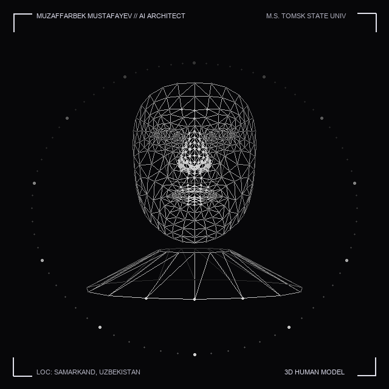

<div align="center">

  <!-- Header Self-Hosted Wave Banner -->
  

  <!-- Animated Hologram Dot Matrix Avatar -->
  <p align="center">
    <a href="https://muzaffarbek.uz">
      
    </a>
  </p>

  <!-- Dynamic Typing Animation -->
  <a href="https://muzaffarbek.uz">
    
  </a>

  <p align="center">
    <a href="https://muzaffarbek.uz">
      
    </a>
    <a href="https://t.me/MuzaffarbeksPortfolio">
      
    </a>
    <a href="https://www.linkedin.com/in/muzaffarbek-mustafayev-121846278">
      
    </a>
    <a href="mailto:muzaffarbekmustafayev@gmail.com">
      
    </a>
  </p>

  <!-- Quick Status Pill -->
  <p align="center">
    
    
    
  </p>

</div>

---

## 👨‍💻 Executive Summary

> *"I transform complex engineering challenges into clean, resilient, and scalable digital architectures."*

I am **Muzaffarbek Mustafayev**, a **Senior Software Engineer** and **AI & Financial Systems Architect** based in **Samarkand, Uzbekistan**. My engineering practice bridges robust backend systems, high-performance web applications, real-time media communications, and cutting-edge Artificial Intelligence (ASR, LLM integrations, and terminal automation).

### ⚡ Fast Facts & Highlights
- 🏛️ **Academic Excellence:** Master of Science (M.S.) at **Tomsk State University** & Bachelor of Science (B.S.) at **Samarkand State University** (State Budget Grantee).
- 💼 **Primary Focus:** High-throughput Node.js/Python microservices, scalable React/Next.js client ecosystems, and AI-driven automation.
- 🎙️ **Specialized Domain:** Real-time WebRTC media pipelines, Speech Recognition (ASR), and intelligent developer tooling.
- 🌐 **Languages:** Uzbek (Native), English (Professional Working / CEFR B2), Russian (Fluent / Professional).

---

## 🛠️ Technical Stack & Engineering Arsenal

<div align="center">

<p align="center"><b>💻 Core Technologies at a Glance</b></p>

<a href="https://muzaffarbek.uz">
  
</a>

</div>

<br/>

| Domain | Technologies & Frameworks | Key Practices |
| :--- | :--- | :--- |
| **Frontend & Mobile** | `React.js` `Next.js` `TypeScript` `JavaScript (ESNext)` `React Native` `Tailwind CSS` `Vite` `Redux Toolkit` | Component-driven UI, SSR/SSG, Glassmorphism, Micro-interactions, Responsive UX |
| **Backend & Microservices** | `Node.js` `Express.js` `Python` `FastAPI` `RESTful APIs` `GraphQL` `WebSockets` `WebRTC` | Clean Architecture, Async Pipelines, High-concurrency Event Loops, JWT Security |
| **Artificial Intelligence** | `Google Antigravity (AGY)` `Gemini 3.8/3.7` `Claude Sonnet/Opus` `OpenAI API` `ASR (Speech-to-Text)` `Audio Denoise` | Prompt Engineering, Context Window Management, Headless Agents, Rolling Quota Systems |
| **Databases & Caching** | `PostgreSQL` `MongoDB` `Redis` `SQLite` `Prisma ORM` `Mongoose` | ACID Compliance, Indexing & Query Optimization, Cache Invalidation, Relational Modeling |
| **DevOps & Cloud** | `Docker` `Linux (Ubuntu/Debian)` `Git & GitHub Actions` `Nginx` `CI/CD Pipelines` `Postman` | Containerization, Reverse Proxies, Automated Testing, Environment Secrets Security |
| **System Tools & Design** | `Figma` `curl` `PowerShell` `Bash` `Zsh` `Vim` | UI/UX Prototyping, Shell Scripting, Automation Hooks, Terminal Daemon Management |

---

## 🏆 Featured Projects & Key Case Studies

<table width="100%">
  <tr>
    <td width="50%" valign="top">
      <h3>🚀 <a href="https://github.com/muzaffarbekmustafayev/antigravity">Antigravity Remote Terminal</a></h3>
      <p><b>Secure Multi-Session Telegram Terminal & AI Bridge</b></p>
      <p>A multi-session Telegram bot connecting chat directly to Google Antigravity (AGY) CLI agent. Features interactive session cards, model switching, speed effort modes, 5-hour rolling limit tracking, and instant Git commit synchronization.</p>
      <p><code>Node.js</code> <code>Telegram Bot API</code> <code>AGY CLI</code> <code>Child Process</code> <code>REST Webhooks</code></p>
    </td>
    <td width="50%" valign="top">
      <h3>🌐 <a href="https://muzaffarbek.uz">Portfolio & Engineering Showcase</a></h3>
      <p><b>High-Performance Personal Platform (muzaffarbek.uz)</b></p>
      <p>Official portfolio platform featuring multi-language internationalization (Uzbek/English/Russian), dark/light theme persistence, interactive skills matrix, verified credentials showcase, and live GitHub sync.</p>
      <p><code>React</code> <code>Vite</code> <code>Tailwind CSS</code> <code>i18next</code> <code>Space Grotesk</code></p>
    </td>
  </tr>
  <tr>
    <td width="50%" valign="top">
      <h3>🗺️ <a href="https://github.com/muzaffarbekmustafayev/mobile-gis-application">Mobile GIS Application</a></h3>
      <p><b>Geographic Information & Real-Time Tracking Ecosystem</b></p>
      <p>Full-stack mobile and web GIS solution featuring interactive geospatial data visualization, real-time backend reports, and mobile spatial data collector.</p>
      <p><code>React Native</code> <code>Node.js</code> <code>PostGIS/PostgreSQL</code> <code>Leaflet/Mapbox</code></p>
    </td>
    <td width="50%" valign="top">
      <h3>🎙️ Denoise Voices</h3>
      <p><b>Acoustic AI Speech Enhancement System</b></p>
      <p>Intelligent audio processing service that isolates clean human voice frequencies and eliminates background acoustic noise for clear communication pipelines and ASR feeds.</p>
      <p><code>Python</code> <code>Audio Processing</code> <code>Machine Learning</code> <code>FastAPI</code></p>
    </td>
  </tr>
</table>

---

## 📜 Verified Professional Certifications

Directly verified technical credentials from leading engineering organizations:

- 🏅 **[Introduction to Generative AI](https://www.coursera.org/account/accomplishments/certificate/0060P87PCIAB)** — **Google Cloud** *(May 2025 · ID: `0060P87PCIAB`)*
- 🏅 **[Developing Back-End Apps with Node.js and Express](https://www.coursera.org/account/accomplishments/certificate/U5FRGVD6180H)** — **IBM** *(June 2025 · ID: `U5FRGVD6180H`)*
- 🏅 **[Programming with JavaScript](https://www.coursera.org/account/accomplishments/certificate/NZQUT5PI01F7)** — **Meta** *(June 2025 · ID: `NZQUT5PI01F7`)*
- 🏅 **[Authentic Node.js WebSocket Server Workshop](https://www.coursera.org/account/accomplishments/certificate/BNR3LVCVVJJS)** — **Google Cloud** *(June 2025 · ID: `BNR3LVCVVJJS`)*
- 🏅 **[Introduction to Front-End Development](https://www.coursera.org/account/accomplishments/certificate/REDBAEMLBRUA)** — **Meta** *(June 2025 · ID: `REDBAEMLBRUA`)*

---

## 📊 Live GitHub Telemetry & Activity

<div align="center">

  <!-- Live GitHub Streak Card (Verified Working) -->
  <p align="center">
    <a href="https://github.com/muzaffarbekmustafayev">
      
    </a>
  </p>

  <!-- Real-Time Metrics & Telemetry Badges -->
  <p align="center">
    
    
    
    
  </p>

</div>

---

## 🎯 Engineering Philosophy & Principles

```
  ┌────────────────────────────────────────────────────────────────────────┐
  │  01. USER-CENTRIC DESIGN                                               │
  │      Prioritize intuitive ergonomics and sub-100ms UI responsiveness. │
  │                                                                        │
  │  02. RESILIENT ARCHITECTURE                                            │
  │      Design modular systems with graceful degradation and observability│
  │                                                                        │
  │  03. SECURITY-FIRST STANDARDS                                          │
  │      Strict principle of least privilege, sanitization, and encryption.│
  │                                                                        │
  │  04. CONTINUOUS REFACTORING                                            │
  │      Clean, self-documenting codebases that scale across engineering. │
  └────────────────────────────────────────────────────────────────────────┘
```

---

## 📫 Connect & Collaborate

I am always keen to discuss technical architectures, open-source initiatives, and high-impact software ventures.

<div align="center">

| Platform | Channel / Handle | Action |
| :---: | :---: | :---: |
| 🌐 **Official Website** | **muzaffarbek.uz** | [Visit Website](https://muzaffarbek.uz) |
| 💬 **Telegram Contact** | **@MuzaffarbeksPortfolio** | [Direct Message](https://t.me/MuzaffarbeksPortfolio) |
| 💼 **LinkedIn Profile** | **Muzaffarbek Mustafayev** | [Connect on LinkedIn](https://www.linkedin.com/in/muzaffarbek-mustafayev-121846278) |
| 📺 **YouTube Channel** | **@muzaffarbekmustafayev** | [Subscribe on YouTube](https://www.youtube.com/@muzaffarbekmustafayev) |
| 📸 **Instagram** | **@muzaffarbekmustafayev** | [Follow on Instagram](https://www.instagram.com/muzaffarbekmustafayev/) |
| 📧 **Direct Email** | **muzaffarbekmustafayev@gmail.com** | [Send an Email](mailto:muzaffarbekmustafayev@gmail.com) |

<br/>

<!-- Footer Self-Hosted Wave Banner -->


<p align="center">
  <sub>© 2026 Muzaffarbek Mustafayev. Crafted with precision for software engineering excellence.</sub>
</p>

</div>
